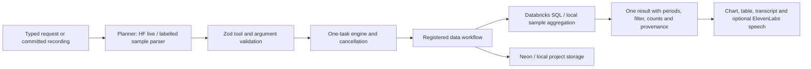

# How InsightOS works

The first supported workflow is CSV revenue exploration. The same UI and cancellation engine support typed or committed voice requests.

`shared/engine.ts` registers modules, rejects overlap, checks generation and AbortSignal before every tool and commit, and stages state updates until all actions succeed. It imports no analytical business logic. `src/workflows/data.ts` implements the tools and returns actual result references, state, and short summaries. Shared schemas allow only implemented tools and their permitted arguments. HF output gets at most one repair. Save, restore, and undo must be standalone plans because they change history or external persistence.

`server/providers/databricks.ts` owns SQL construction, ingestion, and statement polling. Dates and inserted values are parameters; catalog/schema identifiers are validated. Tables are named from a SHA-256 dataset hash, isolating imported datasets. The schema is a fixed six-column contract. Common-location eligibility uses continuous full-period coverage, not intersection of revenue rows. Pagination is bounded and truncation rejected. A cancelled running statement gets a cancellation request. Result validation rejects invalid numeric output.

There is one computed AnalysisResult, not separate AI numbers for each view. It carries source version, periods, active filter, counts, query reference, and formula. The chart, table, summary, and percentage explanation all use it. A top-three view leaves the overall totals unchanged. Local aggregation uses integer cents; live SQL uses decimal amounts.

Before-state versions support actual undo. Save includes the dataset, result, view, versions, preferences, and last settled task summary; Neon and local storage implement the same project contract. The private-session owner is intentionally a single-user pilot. Provider secrets stay on the backend. In-flight database writes may finish after cancellation; Stop prevents stale UI changes and further queued actions, not transactional rollback of remote effects.

Voice records one push-to-talk utterance (maximum 30 seconds), sends it once to batch ElevenLabs transcription, then uses the same engine. Generation checks suppress late transcription/playback, recording stops the microphone tracks, and starting a new request stops spoken feedback. The full text remains accessible when voice is disabled or unavailable. Provider requests have bounded timeouts. Live ElevenLabs STT/TTS passed; real laptop microphone and speaker behavior still need manual verification.

Electron uses sandboxing, context isolation, no renderer Node, media permission limited to its trusted app origin, blocked external navigation/popups, and a narrow CSV-selection IPC bridge. Browser mode uses a real file input. A deployed UI/API can use one HTTPS origin, with the desktop optionally loading it; that remote path is not yet tested.

To add another workflow: define its validated state in the workspace schema union, add tool argument schemas, implement WorkflowModule, register it, and render its artifact view. Keep microphone, session, planner validation, task engine, and storage. Only the data state is registered today; a registry is not proof of additional working workflows.

A separate computer controller now implements real Python files/execution, VS Code launch, headed Chromium navigation and selected-window capture. Pixel interpretation passed live Hugging Face requests with a synthetic fixture and native buddy screenshot; the end-to-end user-selected window flow still needs rehearsal. Native Excel, presentation export and unrestricted OS automation remain outside scope. This team's live routes use Qwen3 Coder and Qwen3 VL; the older Qwen2.5 code fallbacks may be unavailable on another account. Databricks and Neon adapters still need live execution.

## Computer action layer

`shared/computer.ts` defines the discriminated contract. `server/computer/controller.ts` serializes actions using actual server-owned state. Plans receive fresh browser observations, not renderer-supplied targets. Computer actions have real external effects; completed writes remain after Stop.

The native folder picker grants a directory using a private bridge key unavailable to the renderer. Files use exclusive creation and unique names; Python verifies SHA-256 and runs disk source through a restricted computation runner. Editor launch uses a configured executable without a shell. This is not an OS sandbox for hostile code.

Playwright uses a separate headed Chromium context, bounded observation, snapshot IDs and pre-action label checks. Guards stop checkout/payment/personal/account and unknown-button actions for manual review. Public HTTPS routing excludes private destinations, downloads and popups.

Screen IPC requires a chooser and one source. A fresh snapshot is previewed locally; only an explicit description request uploads it to HF vision. Images are omitted from planning and saved CSV projects. Computer state is ephemeral; written files persist. See [COMPUTER-DEMO.md](COMPUTER-DEMO.md).
