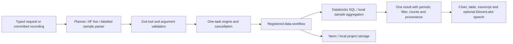

# How InsightOS works

## October 11, 2026, 11:25 UTC — integrated diagrams, verified charts and visual layout

New source uses the same authoritative ordered deck and working-file transaction for text, graph, chart and layout edits. Operations bind project/revision/stable slide ID, validate candidates before promotion and advance dependent bindings after a commit. Stale/cancelled callbacks cannot continue. Local file, native selection and verified cloud save remain separate outcomes.

- **Graphs:** typed bounded graph → deterministic measured scene → native editable PowerPoint boxes/diamond/arrows. Insertion and edge-grounded step insertion preserve unrelated slides. Narration follows graph edges rather than reading an unordered collection of labels. One decision, two branches, up to seven nodes; unsupported loops or arbitrary topology editing are not claimed.
- **Charts:** current server-owned Studio source → fresh Databricks query → reconciliation against local source → frozen aggregate snapshot → ordered chart slide. Revalidate source identity immediately before atomic file publication. Snapshot values and provenance survive undo/save/resume; readback checks the output hash and never silently reruns the query. Detailed source-row evidence remains local. Native chart and embedded workbook values match.
- **Layout:** optional title scale, image side and single/two-column settings retain legacy geometry by default. Content, source identity and reading order are preserved. The same scene drives export and an embedded validated layout manifest. Spoken appearance reports require matching saved-file hash and semantic identity. Older exports need a normal structured export before this evidence exists. Graph/chart logic/data readback is supported, but their spatial narration and a spatial React preview are not part of D.
- **Persistence:** version 3 session envelope contains the ordered V2 deck, graph/layout/chart snapshot and history. Migrations preserve stable IDs and do not call inference. Neon contains owner-scoped structured state; source bytes/absolute bindings/output files stay local. A remote save is read back and compared before acknowledgement.

Source passes integrated automated checks and isolated real-provider/file persistence lifecycles, but is **not yet loaded in the accepted user runtime**. Current release blocker is revision-model reliability and semantic fidelity; see the latest `AGENTS.md` and `VERIFICATION.md`. Current user Pet r4 remains unchanged.

## October 11, 2026, 10:26 UTC — newer Phase A source, release gate pending

Source now binds semantic operations to stable slide IDs and project revisions, carries per-turn UUIDs, retains bounded durable operation receipts, stages compatible same-slide changes together, and reports partial completion across independent actions. Pending failed work is diagnostic until explicitly retried; source/target clarifications retain executor bindings. Cancellation reconciles an already committed result without replaying it. Content fitting can offer an explicit continuation split while preserving the original slide ID, font and complete ideas. Local file, native view and cloud readback statuses remain separate. Cloud saves are verified by readback, not inferred from a request returning.

The provider transport accepts an optional strict JSON-schema response contract, forwarded unchanged through the authenticated cloud inference endpoint. Schema acceptance does not establish semantic truth; content fidelity remains under investigation. Current source passes automated build/software checks, but actual HF completion is below its release target. It is **not yet loaded into the user's accepted checkpoint-zero runtime**.

Phase B includes unconnected typed graph validation/edit/narration and deterministic measured scene layout. The scene owns geometry, font metrics, stable element identities, reading order and branch paths. Future renderers and spoken visual review must use the same scene. These modules are preparation, not a live feature. See the newest verification checkpoint for evidence and limitations.

## October 11, 2026, 09:50 UTC — user runtime upgraded

Checkpoint-zero production build is now running after the user's normal tray Quit and relaunch. Pet Behavior r4 restored with identical seven-slide ordered content/history to the same working filename; native PowerPoint verified one current Pet window and slide one. Its regenerated file hash and three-entry history match actual Neon readback at 09:49:32.987 UTC (`.local/single-file-production-neon-verification.json`). Phase A stable target binding is subsequent source work; it is not yet in this accepted runtime build.

## October 11, 2026, 09:47 UTC — stable working presentation implementation

New source replaces visible revision-per-file exports with `PresentationWorkingFiles`: one verified working path per project, private immutable revision bytes, guarded atomic publication, prepared rollback, commit journal and owner-scoped active pointer. `working.json` retains the committed structured session/history and local source bindings; cloud synchronization remains explicit. Output roots are separate from source staging roots. Native refresh refuses dirty/changed files, refreshes only the owned view, and verifies the new file and target slide. Selection receipts include project/revision/hash, so filename reuse cannot accept stale callbacks. Windows may briefly reload the same file; this is not live COM shape editing or arbitrary imported PPTX support.

The current user checkpoint is Pet Behavior r4, seven slides, saved to Neon at 09:26:55 UTC. The new path passed 724 automated tests and actual isolated PowerPoint publication/repeated-edit/restoration/restart checks; `.local/same-file-native-verification.json` records the scope. Production restart is still pending the user's normal tray Quit after automatic approval blocked force-stop. Historical unique-file behavior and checkpoints below are superseded by this source design; do not claim the running old controller has been upgraded yet. See latest AGENTS.md for exact checkpoint and ongoing Phase A work.

## October 11, 2026, 08:26 UTC — pet-deck repair and native recovery verified

**Current user project is Understanding Pet Behavior, revision 3, seven slides, file insight-presentation-r3-c9c2fa8c.pptx.** It supersedes pet revision 1 and every older Site/Cyber Monday checkpoint. Do not resume an older recovery snapshot over it. Original pet recovery files remain preserved under .local/pet-recovery-*; latest full state, checkpoint and Neon row are .local/pet-final-*.

Actual production typed UI request expanded slide two from **48 to 86 body words**. The following exact summary request through the production API added slide seven. Stable slide identity/font and the other five slides remained unchanged; the summary preserved all six preceding slides. Original file hash and PPTX counts passed. Receipt: .local/pet-content-repair-verification.json. Actual expanded and summary exports were rendered and visually checked with no clipping or overlap (.local/pet-actual-file-qa/r2-export-check.json and r3-export-check.json). The renderer produced complete PNGs before exiting 1 during teardown.

Revision 3 was saved to the same owner-scoped Neon project at 08:01:15.905 UTC. Direct SELECT at 08:01:31.200 UTC matched the active ordered deck, local session and output hash: seven slides, two undo entries, zero sources. Receipt: .local/pet-final-neon-verification.json. Do not use .local/resume-pet-recovery.ts now: it targets the original revision-1 snapshot.

General fixes: terminal failures end their executable queue while retaining bounded failure context; explicit new operation plans cannot revive that queue through model retry metadata. Explicit retries and matching corrections remain. Qwen revises content fields only; the app retains slide IDs, image references, layout and font. Topic-appropriate bounded rewriting and measured readability/numeric checks remain. An isolated compiled-controller test with the captured failure injected at execution then actual HF summary produced seven slides without replaying the failed edit (.local/pet-failed-summary-compiled-TvC53P/receipt.json). Three actual compiled HF expansion probes passed, preserving unrelated slides.

Final gate: **664/664 unit tests, 48 files, 16.73 seconds; production build and TypeScript passed.** Logs: .local/pet-repair-final2-unit.log and .local/pet-repair-final2-build.log. Current Electron runs that production build. No model switch, fine-tuning, new sponsor integration or native helper change was made.

**Native recovery completed at 08:26 UTC:** the user approved force-closing the frozen process, but a fresh check found PowerPoint had recovered by itself. No force-close/restart was performed. A typed “Open the presentation” through Insight verified slide seven; “Go to slide two” then verified slide two in both backend and the actual PowerPoint View Indicator. Managed opening retired the old same-project windows and left exactly one current project window plus six unrelated recovery windows. Current revision 3, ordered content and file hash remain unchanged from the Neon save. Receipts: .local/pet-recovered-native-open.json, .local/pet-recovered-native-slide-two.json, .local/pet-native-recovery-final.json. Earlier automatic opening did fail while Office restored its old recovery windows; this later explicit opening succeeded. Physical microphone was not exercised in this repair. Rehearse voice and record next; sponsor/chart additions remain deferred.

## October 11, 2026, 07:09 UTC — final recovery gate and active checkpoint

**Preserve the active user project: Site in One-Day Campaign, revision 10, six slides**, file `insight-presentation-r10-e12d6627.pptx`. It is open in PowerPoint with slide six verified and saved to Neon. This supersedes r5, r6, r8, r9 and earlier Cyber Monday checkpoint instructions. The original r5 file and its SHA remain preserved; do not restore it over the current revision.

The current app's typed UI rehearsal expanded slide two **16 → 62 body words**, shortened it to **37**, then undid that change to restore the exact expanded deck. The other five slides remained unchanged. Receipt: `.local/revision-text-invariants.json`. The current deck therefore has its expanded slide two, not an automatic rewrite of every older slide. New generations use richer, distinct explanatory content; detail direction, meaningful change, factual numbers and measured readability are validated before commit. No model switch or fine-tuning was introduced.

Actual native PowerPoint opening now passed on the first request: adding a summary created r9 with seven slides and verified slide 7 of 7; undo created r10 with six slides and verified slide 6 of 6. Each action left exactly **one window for this project and five unrelated presentations**. No extra Open click or manual PowerPoint intervention was needed. Receipts: `.local/native-summary-window-receipt.json`, `.local/revision-rehearsal-summary.json`, `.local/native-undo-window-receipt.json`, `.local/revision-rehearsal-undo-final.json`. The helper allows bounded initial readiness within a 45-second overall cancellation budget, uses temporary PowerShell files to avoid command-line length limits, and closes only exact same-project paths with matching hashes and no unsaved changes. These were typed UI tests, separate from physical microphone evidence.

Revision 10 saved to the same owner-scoped Neon project at **07:09:02.400 UTC**. Direct SELECT at **07:09:03.734 UTC** matched the active ordered deck, local session and output hash: six slides, three history entries and one source. Receipt: `.local/revision-progress-neon-verification.json`. The earlier actual r5 verification is retained in `.local/current-rehearsal-neon-verification.json`; it is historical, not the latest saved revision.

Actual Hugging Face Qwen editing of an isolated copy separately passed **16 → 63 → 40 body words**, with the other five slides unchanged; both edited slides were exported and visually inspected (`.local/content-depth-live-e644c6dc/edit-receipt.json`). Fresh six-slide generation passed with body-word counts **9, 47, 46, 44, 43, 39**, the original Marketing image on the cover and all six slides visually inspected (`.local/content-depth-live-cd13283a/receipt.json`). The renderers produced the inspected PNGs before exiting 1 during teardown. Those isolated content tests did not change the active deck, write Neon, operate native Office or use the microphone.

Final source gate: **638/638 unit tests in 47 files, 15.94 seconds**, including 23 focused native-helper tests; production frontend/server build and TypeScript passed. Logs: `.local/revision-final-unit.log`, `.local/revision-final-build.log`. Source is frozen. The user previously confirmed full-sentence capture and live interruption/correction/readback, and physically exercised creation/revisions/summary/undo/save; the latest fixes were verified through typed UI/provider/native tests. Rehearse the corrected flow by voice and record the demo next. Optional chart insertion and new sponsor work remain deferred.

Earlier sections below retain previous architecture and dated evidence; this latest checkpoint and recovery status take precedence.

## Current product and semantic presentation architecture

InsightOS is a Windows voice companion for blind and low-vision people to create, review and revise visual work. Presentations are the focused demo; earlier analytics/energy workflows are secondary. Preserve the latest user checkpoint named above. Tests use separate output files and must never restore an earlier user or QA fixture.

The Electron buddy renders React/TypeScript. Its local Fastify backend owns credentials and ComputerController state. ElevenLabs Scribe supplies realtime transcription; committed speech enters a pause-aware turn buffer, and interruption cancels stale work/playback. Hugging Face Qwen interprets the complete turn using recent conversation, a typed task draft, pending fields, resolved source folder, active deck, last reviewed/verified slide and actual tool outcomes.

The semantic contract in `shared/presentation-intent.ts` distinguishes request, continuation, correction, cancellation and question. It returns validated fields and typed ordered operations. The controller executes these operations directly; it does not translate them back into phrases for a regex dispatcher. Incomplete speech retains its task draft. “No, use dark blue instead” remains a correction; exact whole-task Stop/No cancellation is immediate and deterministic. Questions do not execute edits. A new creation request clears incompatible pending questions without losing a valid follow-up's topic.

Presentation requests reach this interpreter before older presentation handlers or UI screen shortcuts; exact standalone navigation also has a deterministic path. Desktop continuations carry an opaque token tied to the active task. AbortSignal and generation checks prevent obsolete actions and speech. A native slide operation must verify selection and record it through `/api/computer/selected-slide` before a queued edit continues. Failure or cancellation prevents that continuation. Failure evidence retains the requested target separately from verified selection; old image history cannot be presented as a new saved edit. Fresh native result events update semantic evidence without overwriting a later failed operation from a stale snapshot. Saved-file evidence and native view evidence remain separate in the response.

## Ordered deck and editing

`shared/presentation-deck.ts` defines the authoritative V2 ordered deck: 3–10 slides with stable IDs, 0–6 verified PNG/JPG sources, blue/light/dark theme, bounded deck/slide text scale and explicit image-reuse policy. Cover, text, image and process slides can occur in the actual requested order. A chart schema/renderer exists for validated data, but the active-deck verified-chart insertion command is **not implemented**. Legacy picture decks are projected/migrated without inference; their cover + one-per-picture + diagram layout no longer limits new creations.

`server/computer/presentation-deck.ts` plans or revises validated content and writes editable PptxGenJS output. Source IDs and requested slide slots are app-owned, so the model cannot invent image identity or change the requested count. Actual source bytes are retained. Marketing content without supplied results is visibly labeled a proposed plan. The writer validates text fit, preserves image aspect ratio, produces editable text/process shapes/arrows and removes dangling package content-type declarations. Split and large-image layouts are renderer capabilities; there is currently no voice operation to select the large-image layout. Voice-selectable styling covers the three themes and bounded text sizing.

| Operation | Execution and invariant |
| --- | --- |
| Create | 3–10 slides independent of picture count; optional requested image destination and source brief. |
| Read/navigate | Read actual slide content; verify native selection independently when navigation is requested. |
| Expand/shorten/revise | The semantic plan carries the requested detail direction. Validation rejects no-op edits and checks a meaningful word-count change, retained numbers, readability and stable identity; other slides remain unchanged. |
| Style/resize | Three themes and bounded text sizing; layout validation precedes commit. |
| Insert/replace image | V2 changes the target's structured source reference and layout; source hashes are verified. |
| Reorder/summary | Move a stable slide or append a validated summary within the 10-slide limit. |
| Undo | Restore prior deck state from a bounded history of up to eight entries. |
| Save/resume | Explicit versioned session with source checks; resume performs no new inference. |

The presentation workspace renders real slide types/order/count, including process slides wherever they occur; the buddy reports actual source count. Each file revision has a unique name. Original files remain untouched. A per-owner/project local window registry tracks exact output paths and hashes. Managed opening verifies the new revision before retiring unchanged saved windows from that same project; altered or unrelated presentations are retained. First-open readiness uses bounded visible-window checks and a 45-second overall cancellation budget; temporary PowerShell files avoid the Windows command-line length limit. The actual seven-slide revision opened and selected its summary on the first request, retaining exactly one project window and five unrelated presentations. Generated PPTX editing is programmatic, not simulated mouse typing/dragging. Arbitrary imported corporate PPTX editing and independently made Office edits are not imported into the structured model.

Older Insight-generated files without an ordered project retain `presentation-image-edit.ts` recovery: deterministic OOXML insertion/replacement, verified source bytes, preserved unrelated slide parts, a reserved image pane and no repeated text shrinking. Legacy extra-image patches remain distinct from V2 structured attachments and still block structured Neon saving until undone. The older Cyber Monday checkpoint was in that legacy category; the current Site in One-Day Campaign project is V2 and has an actual verified Neon save.

## Persistence and source integrity

`shared/presentation-session.ts` validates V1/V2 and migrates supported saved V1 content/history. V2 saves authoritative ordered state, source references and up to eight prior revisions; `server/providers/presentationStore.ts` uses owner-scoped parameterized Neon JSONB with an atomic local fallback and visible fallback warning. New V2 image attachments join these source references. Raw image bytes, absolute source folders, original-path bindings and output references stay in a private local manifest/cache, not Neon.

Same-laptop resume checks original source hashes/dimensions, retained bindings and optional brief hash before changing state. Missing or changed sources reject restoration. New folder images are not silently substituted. It reconstructs a fresh uniquely named PPTX without inference. Browser sessions, screen goals and pending clarifications are not restored. Research-only decks and unsupported legacy OOXML patches remain outside this saved-session contract.

The separate private `active-presentation.json` checkpoint restores the exact latest generated file after hash/ownership checks. It does not by itself restore structured state or undo, and clears ephemeral native-selection evidence. Explicit save/resume is required for structured recovery.

## Provider and verification status

- Hugging Face hosts `Qwen/Qwen3-Coder-30B-A3B-Instruct:scaleway` for semantics/content and `Qwen/Qwen3-VL-30B-A3B-Instruct:deepinfra` for pictures/supported screen targets. Actual calls passed; the team has not trained or locally hosted these models.
- ElevenLabs Scribe/George Flash voice is connected. HF Whisper and Windows speech remain fallbacks. Preserve the current mic readiness, continuous fallback capture and hesitant-turn assembly improvements.
- Neon V2 passed actual controller create/revise/save/restart/resume at 05:08:35 UTC with real HF and a byte-identical Marketing source copy. Receipt: `.local/ordered-controller-live-IAZULr/receipt.json`. It did not use native Office or the physical microphone; the user's active deck was untouched.
- Export QA produced six-slide dark/blue/light, a shortened revision and seven-slide summary with original source bytes and editable elements. Package/layout checks had zero findings; 31 PNGs were produced and all dark/representative changed slides inspected. The renderer exited nonzero after writing the complete sets. Receipt: `.local/ordered-visual-qa/receipt.json`.
- Databricks separately passed supported Studio ingestion/SQL, source reconciliation and matching Excel/PPT exports at 02:47:27 UTC. Optional phase-three insertion of that verified chart into the active deck has not started.
- Vultr is not deployed; old prepared archives are stale. Tiger Data and Gemini are absent.

Final automated gates passed: 638/638 unit tests in 47 files (15.94 seconds), production frontend/server build and TypeScript. Logs: `.local/revision-final-unit.log` and `.local/revision-final-build.log`. The earlier 21 desktop/image/semantic browser cases passed with mocked native IPC/providers. Actual typed commands in the running buddy selected slide 2 → next slide 3 → last slide 4, confirmed independently by PowerPoint's View Indicator and backend verified-selection state. Receipts: `.local/native-navigation-rehearsal.json` and `.local/native-navigation-final-state.json`; the user checkpoint was unchanged. Inactive-window UI inspection sometimes stayed stale until activation, so that observation is not evidence of a task deadlock. Physical full-sentence capture was user-confirmed at 04:10 UTC. The user subsequently replied “it worked” to the explicit test “Read slide two,” interrupt with “Wait, read slide one,” confirming stopped playback, capture of the correction and slide-one readback in that trial. This is user-reported physical evidence, not independently observed audio. The user has since exercised spoken creation/revisions/summary/undo/save. Repeat the corrected flow before recording; the latest recovery status above takes precedence. See [VERIFICATION.md](VERIFICATION.md).

Persistent continuity files are AGENTS.md, this document, SUBMISSION-PLAN.md, SPONSOR-INTEGRATIONS.md, PRESENTATION-DEMO.md and VERIFICATION.md. Latest code/runtime evidence supersedes historical notes. Keep secrets and private receipts ignored.

## Supporting and earlier analytics architecture

Current presentation feedback separates saved-file evidence from native PowerPoint view verification. Backend insertion leaves `selectedSlide` unset until `/api/computer/selected-slide` records a verified result. `/api/computer/presentation-navigation-failure` clears selection and adds failure evidence to the short conversation; planning receives filename, image edits, opened state and navigation status. Known unsupported completion claims are replaced deterministically with the saved-file/unverified-selection outcome. Exact native-file checkpoints omit ephemeral view verification. The native navigator resolves the expected filename across open decks, rejects duplicate matches, pins the full path, retries temporary opening/busy states within 28 seconds, and clicks at most once.

Folder names resolved with an explicit Desktop/Documents/Downloads answer are remembered for later insertion in this controller session. New presentation topics clear stale folder/style questions; topic fragments do not become directory names. Repeated creation instructions and ordinary questions preserve a pending topic. These boundaries matter independently of which model supplies the plan.

The energy workflow uses `EnergyAssistant` as a bounded conversational coordinator. It handles explicit sample/imported bills, payment limits, improvement choices and user-provided applicant answers. Calculations separate bill-change contributors and compare gross payments against the budget. Browser execution serves exactly one owned synthetic HTTPS document through Playwright interception, fills fixed controls with a visible automation pointer, and compares all eight review values against the plan. No private-network navigation exception or lender submission is added. Readback validates the current DOM without altering it; changes to a plan invalidate prior verification. User-requested saving uses parameterized owner-scoped Neon JSONB storage when connected, otherwise an atomic local file. A restored plan requires fresh browser verification. Optional Databricks uses bound charge/usage parameters, and its results must match independently computed totals before provider attribution. Applicant identity is omitted from the energy slide-generation context. This is a domain workflow, not a general autonomous financial adviser or arbitrary browser application solver.

The main product is a native Windows buddy for conversation and computer tasks. The older CSV revenue workspace remains an optional view. Both accept typed or transcribed requests; they use separate task controllers.

`shared/engine.ts` registers modules, rejects overlap, checks generation and AbortSignal before every tool and commit, and stages state updates until all actions succeed. It imports no analytical business logic. `src/workflows/data.ts` implements the tools and returns actual result references, state, and short summaries. Shared schemas allow only implemented tools and their permitted arguments. HF output gets at most one repair. Save, restore, and undo must be standalone plans because they change history or external persistence.

`server/providers/databricks.ts` owns SQL construction, ingestion, and statement polling. Dates and inserted values are parameters; catalog/schema identifiers are validated. Tables are named from a SHA-256 dataset hash, isolating imported datasets. The schema is a fixed six-column contract. Common-location eligibility uses continuous full-period coverage, not intersection of revenue rows. Pagination is bounded and truncation rejected. A cancelled running statement gets a cancellation request. Result validation rejects invalid numeric output.

There is one computed AnalysisResult, not separate AI numbers for each view. It carries source version, periods, active filter, counts, query reference, and formula. The chart, table, summary, and percentage explanation all use it. A top-three view leaves the overall totals unchanged. Local aggregation uses integer cents; live SQL uses decimal amounts.

Before-state versions support actual undo. Save includes the dataset, result, view, versions, preferences, and last settled task summary; Neon and local storage implement the same project contract. The private-session owner is intentionally a single-user pilot. Provider secrets stay on the backend. In-flight database writes may finish after cancellation; Stop prevents stale UI changes and further queued actions, not transactional rollback of remote effects.

The buddy's primary voice transport is ElevenLabs Scribe v2 Realtime, authenticated with a single-use token issued by our backend. The permanent key stays server-side. Partial speech interrupts output immediately; committed segments enter a bounded turn buffer before the computer controller. Complete turns settle for about 350 ms after commit; unfinished/filler-ended phrases wait about 1.9 seconds for continuation, while short Stop/No bypass the delay. The provider VAD silence threshold is 0.85 seconds. This is finite turn assembly, not perfect semantic endpointing. Startup readiness and the greeting wait for a live microphone track in the installed SDK; a bounded setup failure uses recorded fallback. Flash v2.5 supplies short spoken responses. Recorded fallback keeps its live microphone stream across clips, restarts capture before network transcription, and delivers concurrent results in recording order. Startup noise calibration is capped so first-frame speech stays detectable. Newer pending input suppresses older recognition-error speech. Generation checks suppress stale playback, and Stop closes media/network resources. Live synthetic streaming transcription and Flash generation passed. The user also confirmed the physical read-slide-two → interrupt → read-slide-one trial worked; this is not a general echo-rejection guarantee or a completed spoken creation/editing rehearsal.

Electron uses sandboxing, context isolation, no renderer Node, media permission limited to its trusted app origin, blocked external navigation/popups, and narrow validated IPC bridges for files, capture, native pointer actions, and PowerPoint navigation. Browser mode uses a real file input. A deployed UI/API can use one HTTPS origin, with the desktop optionally loading it; that remote path is not yet tested.

To add another workflow: define its validated state in the workspace schema union, add tool argument schemas, implement WorkflowModule, register it, and render its artifact view. Keep microphone, session, planner validation, task engine, and storage. Only the data state is registered today; a registry is not proof of additional working workflows.

A separate computer controller implements Python files/execution, installed-app launching, editable PowerPoint creation, Excel workbook analysis, headed Chromium navigation and screen capture. This team's live routes use Qwen3 Coder and Qwen3 VL; the older Qwen2.5 code fallbacks may be unavailable on another account. Arbitrary application editing and unrestricted OS automation are not implemented.

## Computer action layer

Multi-step browser and office requests now enter a goal coordinator (`server/computer/goal.ts`). It retains the original goal, latest clarification, observed page and successful step summaries, asks Hugging Face for one validated next action, executes it and observes again. Each turn allows six actions; repeated actions against unchanged observations stop for clarification. Waiting and interrupted goals can continue in the same process. This is one coordinator using typed tools, not independently running agents. Goal state is not restored across backend restarts.

Explicit “remember …” preferences persist through `AssistantMemory`: owner-scoped parameterized Neon SQL when configured, private local JSON otherwise. Conversations, application answers, browser pages and screenshots are not automatically saved as preferences. “What do you remember?” reads them back; “forget my saved preferences” clears only the current owner's notes.

Optional hybrid hosting keeps desktop UI and actions on localhost. `INSIGHTOS_CLOUD_URL` sends authenticated inference requests to `/api/agent/infer` on a deployed backend (intended for Vultr). That service runs Hugging Face calls; it does not execute desktop tools. The deployment package passed 24 checks and Compose validation, but no server is connected; the configured deployment awaits its existing billing/credential approval and the package is stale. Neon presentation persistence is independently connected and verified. The Excel worker can use Databricks and pass its calculated findings into the presentation worker in the same goal.

`shared/computer.ts` defines the discriminated contract. `server/computer/controller.ts` serializes actions using actual server-owned state. Plans receive fresh browser observations, not renderer-supplied targets. Computer actions have real external effects; completed writes remain after Stop.

The native folder picker grants a directory using a private bridge key unavailable to the renderer. Files use exclusive creation and unique names; Python verifies SHA-256 and runs disk source through a restricted computation runner. Editor launch uses a configured executable without a shell. This is not an OS sandbox for hostile code.

Playwright uses a separate headed Chromium context, bounded observation, snapshot IDs and pre-action label checks. Job/product workflows can take several observed steps from one request. It keeps a short recent conversation context for follow-ups. Final payments, application submission and credential entry remain blocked; personal contact fields use a separate confirmation. Public HTTPS routing excludes private destinations and downloads. Only expected click-triggered popups are followed.

Screen IPC captures the main display for an explicit screen request or a chosen window. Named desktop clicks use an HF vision target signed against the capture, a Windows accessibility lookup and a fresh image check before the real pointer moves. A screen goal can execute up to six supported navigation clicks or scrolls with fresh observations. Dedicated folder/app tools can activate verified controls, and PowerPoint navigation verifies the selected slide. App activation checks taskbar names and safe title chrome, retries bounded fresh lookups after launch and captures the result. Planner-generated app commands also invoke the native bridge. The buddy returns with `showInactive()` and a shared hide lease to retain target focus and prevent overlapping cancelled actions from exposing the overlay during a new capture. The installed Office rehearsal used a real title-bar focus click followed by COM navigation because thumbnails were not accessible. None of these tools provides arbitrary desktop typing or dragging. Images are omitted from ordinary command planning and saved CSV projects. Browser/screen goal state is ephemeral; written files and explicitly saved image-deck sessions persist. See [PRESENTATION-DEMO.md](PRESENTATION-DEMO.md).

`server/providers/workbookAnalytics.ts` connects the buddy's Excel feature to Databricks. An explicit request to use Databricks sends only the selected numeric measure and category in a parameterized VALUES query. SQL calculates count, total, average and the highest aggregate category; the returned statement ID is retained in the result. This path does not create user tables. Ordinary Excel requests remain local, and missing or failed Databricks access never becomes a falsely labelled cloud result. The laptop has connected warehouse credentials. The separate constrained Studio analysis-to-Excel/PPT rehearsal passed on October 11 at 02:47 UTC; this does not establish arbitrary Excel UI editing or insertion into the active ordered deck.
