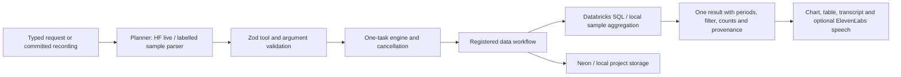

# How InsightOS works

The main product is a native Windows buddy for conversation and computer tasks. The older CSV revenue workspace remains an optional view. Both accept typed or transcribed requests; they use separate task controllers.

`shared/engine.ts` registers modules, rejects overlap, checks generation and AbortSignal before every tool and commit, and stages state updates until all actions succeed. It imports no analytical business logic. `src/workflows/data.ts` implements the tools and returns actual result references, state, and short summaries. Shared schemas allow only implemented tools and their permitted arguments. HF output gets at most one repair. Save, restore, and undo must be standalone plans because they change history or external persistence.

`server/providers/databricks.ts` owns SQL construction, ingestion, and statement polling. Dates and inserted values are parameters; catalog/schema identifiers are validated. Tables are named from a SHA-256 dataset hash, isolating imported datasets. The schema is a fixed six-column contract. Common-location eligibility uses continuous full-period coverage, not intersection of revenue rows. Pagination is bounded and truncation rejected. A cancelled running statement gets a cancellation request. Result validation rejects invalid numeric output.

There is one computed AnalysisResult, not separate AI numbers for each view. It carries source version, periods, active filter, counts, query reference, and formula. The chart, table, summary, and percentage explanation all use it. A top-three view leaves the overall totals unchanged. Local aggregation uses integer cents; live SQL uses decimal amounts.

Before-state versions support actual undo. Save includes the dataset, result, view, versions, preferences, and last settled task summary; Neon and local storage implement the same project contract. The private-session owner is intentionally a single-user pilot. Provider secrets stay on the backend. In-flight database writes may finish after cancellation; Stop prevents stale UI changes and further queued actions, not transactional rollback of remote effects.

The buddy's primary voice transport is ElevenLabs Scribe v2 Realtime, authenticated with a single-use token issued by our backend. The permanent key stays server-side. Partial speech can interrupt output; committed speech enters the computer controller. Flash v2.5 supplies short spoken responses. The recorded Scribe path remains available as fallback and for the older data workspace. Generation checks suppress stale playback, and Stop closes media/network resources. Live synthetic streaming transcription and Flash generation passed; real laptop microphone and speaker echo behavior still need manual verification.

Electron uses sandboxing, context isolation, no renderer Node, media permission limited to its trusted app origin, blocked external navigation/popups, and a narrow CSV-selection IPC bridge. Browser mode uses a real file input. A deployed UI/API can use one HTTPS origin, with the desktop optionally loading it; that remote path is not yet tested.

To add another workflow: define its validated state in the workspace schema union, add tool argument schemas, implement WorkflowModule, register it, and render its artifact view. Keep microphone, session, planner validation, task engine, and storage. Only the data state is registered today; a registry is not proof of additional working workflows.

A separate computer controller implements Python files/execution, installed-app launching, editable PowerPoint creation, Excel workbook analysis, headed Chromium navigation and screen capture. This team's live routes use Qwen3 Coder and Qwen3 VL; the older Qwen2.5 code fallbacks may be unavailable on another account. Arbitrary application editing and unrestricted OS automation are not implemented.

## Computer action layer

`shared/computer.ts` defines the discriminated contract. `server/computer/controller.ts` serializes actions using actual server-owned state. Plans receive fresh browser observations, not renderer-supplied targets. Computer actions have real external effects; completed writes remain after Stop.

The native folder picker grants a directory using a private bridge key unavailable to the renderer. Files use exclusive creation and unique names; Python verifies SHA-256 and runs disk source through a restricted computation runner. Editor launch uses a configured executable without a shell. This is not an OS sandbox for hostile code.

Playwright uses a separate headed Chromium context, bounded observation, snapshot IDs and pre-action label checks. Job/product workflows can take several observed steps from one request. It keeps a short recent conversation context for follow-ups. Final payments, application submission and credential entry remain blocked; personal contact fields use a separate confirmation. Public HTTPS routing excludes private destinations and downloads. Only expected click-triggered popups are followed.

Screen IPC captures the main display for an explicit screen request or a chosen window. Named desktop clicks use an HF vision target signed against the capture, a Windows accessibility lookup and a fresh image check before the real pointer moves. It supports one named native click or scroll per request; browser goals do not imply arbitrary native desktop autonomy. Images are omitted from ordinary command planning and saved CSV projects. Computer state is ephemeral; written files persist. See [COMPUTER-DEMO.md](COMPUTER-DEMO.md).

`server/providers/workbookAnalytics.ts` connects the buddy's Excel feature to Databricks. An explicit request to use Databricks sends only the selected numeric measure and category in a parameterized VALUES query. SQL calculates count, total, average and the highest aggregate category; the returned statement ID is retained in the result. This path does not create user tables. Ordinary Excel requests remain local, and missing or failed Databricks access never becomes a falsely labelled cloud result. The current laptop still needs warehouse credentials and a real query rehearsal.
