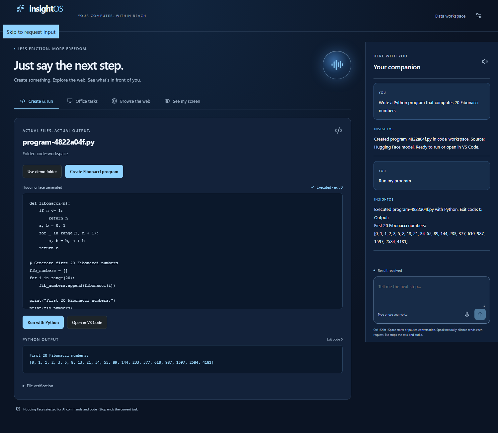

# InsightOS

A voice-first desktop companion for people who have difficulty seeing or operating a computer. It can create, run, and open a real Python program in VS Code from one request; search the web and read numbered results aloud; and describe a one-time main-display snapshot. The CSV module remains under **Data workspace**. See [computer setup and demo](COMPUTER-DEMO.md).

**Verified locally:** the native floating buddy, real Hugging Face planning/code generation and synthetic-image vision, ElevenLabs transcription/speech API calls, Python file creation/execution, VS Code opening, main-display and selected-window capture, visible Chromium search/result navigation, and the original CSV flow. A synthetic audio-to-code-to-VS-Code-to-spoken-reply chain passed. Physical microphone and speaker behavior still need a manual check. See [verification](VERIFICATION.md) and [sponsor status](SPONSOR-INTEGRATIONS.md).



## Run locally

Use Node 24 and npm. From this folder:

```powershell
npm ci
npm run setup:desktop
npx playwright install chromium
Copy-Item .env.example .env
npm run dev
```

No cloud account is needed in default sample mode. `setup:desktop` downloads the Electron runtime if npm's install-script policy skipped it. Keep HOST=127.0.0.1 and PORT=4311 for local Electron. Do not run two copies against the same ports. Close the desktop and stop the development terminal with Ctrl+C.

For a production desktop: `npm run build` then `npm start`. For browser development: `npm run dev:web`, then open `http://127.0.0.1:5173`. For the compiled browser app: build then `npm run start:web`, and open `http://127.0.0.1:4311`.

Set `PYTHON_BIN` and `VSCODE_BIN` to installed executable paths; this laptop is already configured in ignored `.env`. The default screen is the companion; see [COMPUTER-DEMO.md](COMPUTER-DEMO.md).

For the original data demonstration, choose **Data workspace**, then **Try sample data** or open `data/operations-synthetic.csv`. Type:

1. “What is in this file?”
2. “Compare revenue this quarter with last quarter.”
3. “Only include locations that were operating in both quarters.”
4. “Show that as a chart.”
5. “Describe this chart.”
6. “Only show the top three regions.”
7. “What changed?”
8. “How did you calculate that percentage?”
9. “Undo that change.”
10. “Save my workspace.” Close/reopen and choose Saved workspaces, or type “Resume my workspace.”

Expected comparison changes from $204,000 / +52.2% / South to $141,000 / +11.9% / East after the filter. [Fixture calculations and import rules](data/README.md) explain why. Sample planning is a limited deterministic development parser; it does not understand unrestricted requests or explicit arbitrary periods.

## Connect the live demo

Open **Settings & connections → Connect your accounts**. Enter credentials in the masked fields, click **Save**, then **Test**. Saves apply immediately and persist in the local Git-ignored `.env`; secrets are never returned by the API. Start with Hugging Face and ElevenLabs for computer AI and voice. See [SPONSOR-SETUP.md](SPONSOR-SETUP.md) for accounts and fields. Manual `.env` edits still require a restart; never use VITE_* variables for secrets. Computer commands use HF whenever `HF_TOKEN` is present, independently of APP_MODE and Databricks. Data-workspace live planning and analytics require **both** Hugging Face and Databricks. `APP_MODE=live` never substitutes sample results after a provider failure. ElevenLabs and Neon are independently enabled by their credentials, including while developing with sample calculations.

| Configuration                               | Where to get it / requirement                                                                                                                                      |
| ------------------------------------------- | ------------------------------------------------------------------------------------------------------------------------------------------------------------------ |
| `HF_TOKEN`                                  | Hugging Face token permitted to call inference. Provider quota/billing must be available.                                                                          |
| `HF_MODEL_ID`                               | Set to an available text/code inference route. This team's verified route is `Qwen/Qwen3-Coder-30B-A3B-Instruct:scaleway`; the older fallback in code may not be served by your account. |
| `HF_VISION_MODEL_ID`                        | Set to an available vision route. This team's verified route is `Qwen/Qwen3-VL-30B-A3B-Instruct:deepinfra`.                                                       |
| `HF_ENDPOINT_URL`                           | Optional full HTTPS chat-completions endpoint. Default is the HF inference router; a provisioned endpoint must implement the same API.                             |
| `DATABRICKS_HOST`                           | HTTPS workspace origin, e.g. `https://your-workspace.cloud.databricks.com`; no paths or query.                                                                     |
| `DATABRICKS_WAREHOUSE_ID`                   | Existing SQL warehouse ID with permission to run queries.                                                                                                          |
| `DATABRICKS_TOKEN`                          | Authorized personal access token for this pilot. OAuth is not implemented.                                                                                         |
| `DATABRICKS_CATALOG`, `DATABRICKS_SCHEMA`   | Default main/insightos; token needs catalog/schema access and table creation/insert/select permissions. Warehouse availability is not assumed from account signup. |
| `ELEVENLABS_API_KEY`, `ELEVENLABS_VOICE_ID` | Account API key and an accessible voice ID. STT uses batch Scribe v1; TTS uses multilingual v2.                                                                    |
| `DATABASE_URL`                              | Neon Postgres connection string with permission to create/update insightos_projects. Keep it private.                                                              |
| `SESSION_PASSPHRASE`, `CLIENT_ORIGIN`       | Hosted single-user session password and exact HTTPS frontend origin. See deployment guide.                                                                         |
| `INSIGHTOS_APP_URL`                         | Optional production desktop HTTPS origin for a deployed backend/UI. Leave empty locally.                                                                           |

Run `npm run seed:databricks` to seed the synthetic dataset. Live CSV analysis also ingests the selected file into a content-addressed table using a bounded parameterized procedure. The app discloses the upload. No arbitrary user spreadsheets, formulas, SQL, or database tables are accepted.

Run `npm run check:providers` after configuration. It makes real configured inference, analytics, storage, and speech requests; it may consume credits and retains a synthetic Neon smoke project. The report goes to ignored `.local/provider-verification.json`. Add `VOICE_SMOKE_FILE` pointing to your recorded WAV/WebM/OGG/MP4 to verify transcription. Generated speech is `.local/provider-check.mp3`. A successful response still needs actual laptop microphone/playback/Stop verification. Missing configuration is reported as such, not a pass.

Neon schema is in `migrations/001-projects.sql` and is also initialized by the adapter. Saved JSON includes file data, results/provenance, up to 20 undo versions, selected view, preferences, and the last completed/error/cancelled task summary. Local preferences also persist in the browser. No background job resumes automatically. Local development saves live in ignored `.local/projects`. Do not share these files when importing private data.

## Checks and handoff

```powershell
npm test
npx playwright install chromium
npm run test:e2e
npm run build
npm run test:desktop
npm audit
```

E2E starts its own local backend/UI. Desktop smoke requires the build and a free 4311 port. It launches actual Electron but stubs the OS file-dialog selection; complete the manual native picker check in [VERIFICATION.md](VERIFICATION.md).

Read [COMPUTER-DEMO.md](COMPUTER-DEMO.md) for the buddy demo, [ARCHITECTURE.md](ARCHITECTURE.md) for technical explanations, [deploy/README.md](deploy/README.md) for the unverified Docker/Vultr handoff, and [DEVPOST-DRAFT.md](DEVPOST-DRAFT.md) for submission copy. [SUBMISSION-PLAN.md](SUBMISSION-PLAN.md) lists the judging targets, deadlines and remaining evidence.

The product creates and runs computation-only Python, opens its actual files in VS Code, operates a dedicated Chromium browser, captures an explicitly selected window, and offers a separate CSV data workspace. HF vision passed a synthetic-image request, but selected-window interpretation needs a live manual rehearsal. Universal desktop control, native Excel editing, presentations/PPTX, continuous transcription, multi-user authentication, and installed-app packaging are not implemented. Databricks, Neon, Docker/Vultr, laptop audio and actual screen-reader usability remain unverified. No accessibility certification or award is claimed.

[Knight Hacks requirements](https://knight-hacks-ix.devpost.com/) checked October 10: submit by October 11 at 10 AM local event time; stop GitHub commits at 11 AM. Plan on Eastern time and follow any newer organizer instructions. Include both teammates, a public repository, and demo video. Nothing has been published or submitted by this build.
