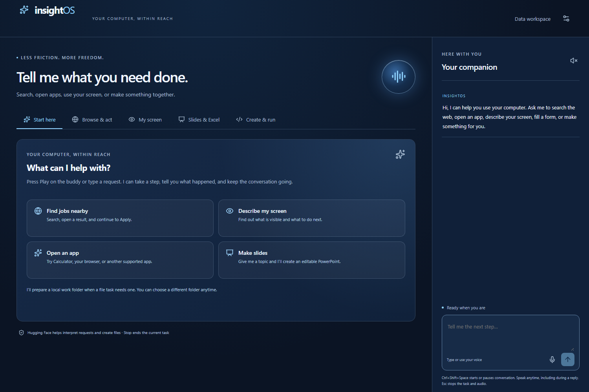

# InsightOS

**Finance, within reach:** InsightOS now turns household transaction spreadsheets into a voice-guided finance workspace. Import CSV/XLSX, hear spending changes, test hypothetical budget reductions, compare a fixed-rate payment with a personal limit, undo changes, and export a real Excel workbook or create PowerPoint slides. The floating desktop buddy keeps the same conversation. Open the **Finance & Excel** tab or `http://127.0.0.1:5173/?workspace=finance` while developing.

For the focused hackathon demo, say: “Start the finance demo” → “Why did my spending increase?” → “What happens if I spend one hundred dollars less on groceries?” → “Check a $1200 loan at 12% APR over 24 months with a $30 limit” → “Change the payment limit to $60” → “Export my finance Excel workbook.” Sample data is labeled. Calculations use integer cents; the AI interprets requests rather than inventing totals. `npm run test:finance` exercises the real HF intent call and generated Excel/PPTX files. See [recording sequence](COMPUTER-DEMO.md#finance-recording-sequence).

Finance Databricks SQL is implemented with bound parameters and exact reconciliation, but warehouse credentials are still missing. Vultr Settings now accepts an HTTPS inference origin and its passphrase; the service must actually be deployed before claiming Vultr use. Existing community energy tools remain available under **Energy & affordability**. Current verified sponsor use is Hugging Face and ElevenLabs.

A voice-first desktop companion for people who have difficulty seeing or operating a computer. Start a conversation with the center Play button, interrupt a reply, and ask it to open an app, find a job or product, make an editable PowerPoint, analyze a workbook, write/run code, or describe and click a named screen control. It starts as a general assistant; file tasks prepare a local workspace only when needed. The CSV module remains under **Data workspace**. See [computer setup and demo](COMPUTER-DEMO.md).

**Verified locally:** the native floating buddy, real Hugging Face planning/code generation and vision, ElevenLabs transcription/speech API calls, editable PowerPoint generation and launch, calculated Excel analysis and launch, Python/VS Code, screen capture, controlled browser search and form filling, and the original CSV flow. An isolated Electron test used the configured Hugging Face vision model to find a synthetic local button, then moved the real Windows pointer, clicked and scrolled that page, and rejected reuse of the same capture token. A synthetic audio-to-code-to-VS-Code-to-spoken-reply chain passed. The user reported working microphone input and spoken web output before the conversation-mode change; the combined live microphone, speaker interruption, and click on an ordinary site still need a physical rehearsal. See [verification](VERIFICATION.md) and [sponsor status](SPONSOR-INTEGRATIONS.md).



## Run locally

**Energy and affordability demo:** say “Start the energy demo,” give a monthly payment limit, choose an improvement, then ask “Prepare my energy application.” Use “use demo details” for a fictional applicant. Insight fills and verifies a real browser rehearsal, catches payments above the stated limit, and reads the answers back. Say “save my energy plan” to save explicitly and “resume my energy plan” to restore it. Saved plans use Neon when connected, otherwise local storage. No application is sent to a utility or lender. See the energy sequence in [COMPUTER-DEMO.md](COMPUTER-DEMO.md). `npm run test:energy` exercises correction, browser verification, and live Hugging Face slide generation when configured.

The desktop shortcut **InsightOS** opens the buddy without a terminal. Its launcher reuses running development services or starts the compiled app when they are stopped. Run `npm run build` after code changes before using the compiled app.

The buddy now supports an observe → act → check loop for multi-step browser and office goals. For a read-only rehearsal, ask “Open https://books.toscrape.com and then open Travel. Tell me the first book's price.” A real Hugging Face rehearsal completed navigation and read the displayed result; see `artifacts/goal-rehearsal.json`. Requests may ask for clarification or stop at site barriers. This does not establish reliable shopping checkout or arbitrary application control.

Say “Remember that I prefer remote jobs,” then “What do you remember about me?” Explicit preferences survive restart locally, or in Neon when `DATABASE_URL` is connected. Goal/browser sessions do not survive backend restart. Optional Vultr-hosted inference uses `INSIGHTOS_CLOUD_URL` and `INSIGHTOS_CLOUD_PASSPHRASE` while the desktop stays local; see the deployment guide. Cloud/Neon/Databricks account checks remain outstanding.

Use Node 24 and npm. From this folder:

```powershell
npm ci
npm run setup:desktop
npx playwright install chromium
Copy-Item .env.example .env
npm run dev
```

No cloud account is needed in default sample mode. `setup:desktop` downloads the Electron runtime if npm's install-script policy skipped it. Keep HOST=127.0.0.1 and PORT=4311 for local Electron. Do not run two copies against the same ports. Close the desktop and stop the development terminal with Ctrl+C.

For a production desktop: `npm run build` then `npm start`. For browser development: `npm run dev:web`, then open `http://127.0.0.1:5173`. For the compiled browser app: build then `npm run start:web`, and open `http://127.0.0.1:4311`.

Set `PYTHON_BIN` and `VSCODE_BIN` to installed executable paths; this laptop is already configured in ignored `.env`. The Office flows detect the standard Windows Office16 location, or use `POWERPOINT_BIN` and `EXCEL_BIN` for custom installations. The default screen is the companion; see [COMPUTER-DEMO.md](COMPUTER-DEMO.md).

For the original data demonstration, choose **Data workspace**, then **Try sample data** or open `data/operations-synthetic.csv`. Type:

1. “What is in this file?”
2. “Compare revenue this quarter with last quarter.”
3. “Only include locations that were operating in both quarters.”
4. “Show that as a chart.”
5. “Describe this chart.”
6. “Only show the top three regions.”
7. “What changed?”
8. “How did you calculate that percentage?”
9. “Undo that change.”
10. “Save my workspace.” Close/reopen and choose Saved workspaces, or type “Resume my workspace.”

Expected comparison changes from $204,000 / +52.2% / South to $141,000 / +11.9% / East after the filter. [Fixture calculations and import rules](data/README.md) explain why. Sample planning is a limited deterministic development parser; it does not understand unrestricted requests or explicit arbitrary periods.

## Connect the live demo

Open **Settings & connections → Connect your accounts**. Enter credentials in the masked fields, click **Save**, then **Test**. Saves apply immediately and persist in the local Git-ignored `.env`; secrets are never returned by the API. Start with Hugging Face and ElevenLabs for computer AI and voice. See [SPONSOR-SETUP.md](SPONSOR-SETUP.md) for accounts and fields. Manual `.env` edits still require a restart; never use VITE_* variables for secrets. Computer commands use HF whenever `HF_TOKEN` is present, independently of APP_MODE and Databricks. Data-workspace live planning and analytics require **both** Hugging Face and Databricks. `APP_MODE=live` never substitutes sample results after a provider failure. ElevenLabs and Neon are independently enabled by their credentials, including while developing with sample calculations.

| Configuration                               | Where to get it / requirement                                                                                                                                                            |
| ------------------------------------------- | ---------------------------------------------------------------------------------------------------------------------------------------------------------------------------------------- |
| `HF_TOKEN`                                  | Hugging Face token permitted to call inference. Provider quota/billing must be available.                                                                                                |
| `HF_MODEL_ID`                               | Set to an available text/code inference route. This team's verified route is `Qwen/Qwen3-Coder-30B-A3B-Instruct:scaleway`; the older fallback in code may not be served by your account. |
| `HF_VISION_MODEL_ID`                        | Set to an available vision route. This team's verified route is `Qwen/Qwen3-VL-30B-A3B-Instruct:deepinfra`.                                                                              |
| `HF_ENDPOINT_URL`                           | Optional full HTTPS chat-completions endpoint. Default is the HF inference router; a provisioned endpoint must implement the same API.                                                   |
| `DATABRICKS_HOST`                           | HTTPS workspace origin, e.g. `https://your-workspace.cloud.databricks.com`; no paths or query.                                                                                           |
| `DATABRICKS_WAREHOUSE_ID`                   | Existing SQL warehouse ID with permission to run queries.                                                                                                                                |
| `DATABRICKS_TOKEN`                          | Authorized personal access token for this pilot. OAuth is not implemented.                                                                                                               |
| `DATABRICKS_CATALOG`, `DATABRICKS_SCHEMA`   | Default main/insightos; token needs catalog/schema access and table creation/insert/select permissions. Warehouse availability is not assumed from account signup.                       |
| `ELEVENLABS_API_KEY`, `ELEVENLABS_VOICE_ID` | Account API key and an accessible voice ID. Primary voice uses Scribe v2 Realtime with temporary client tokens; recorded Scribe remains as fallback.                                     |
| `ELEVENLABS_TTS_MODEL_ID`                   | Defaults to `eleven_flash_v2_5` for short conversational replies.                                                                                                                        |
| `DATABASE_URL`                              | Neon Postgres connection string with permission to create/update insightos_projects. Keep it private.                                                                                    |
| `SESSION_PASSPHRASE`, `CLIENT_ORIGIN`       | Hosted single-user session password and exact HTTPS frontend origin. See deployment guide.                                                                                               |
| `INSIGHTOS_APP_URL`                         | Optional production desktop HTTPS origin for a deployed backend/UI. Leave empty locally.                                                                                                 |

Run `npm run seed:databricks` to seed the synthetic CSV dataset. Live CSV analysis ingests the selected file into a content-addressed table using a bounded parameterized procedure. The buddy has a separate Excel path: explicitly ask **Analyze this workbook with Databricks** to send the selected numeric measure/category for real SQL totals, averages and group ranking. It retains the returned statement ID and fails visibly when credentials are missing. Regular Excel requests stay local. Neither path executes spreadsheet macros or user-supplied SQL.

Run `npm run check:providers` after configuration. It makes real configured inference, analytics, storage, and speech requests; it may consume credits and retains a synthetic Neon smoke project. The report goes to ignored `.local/provider-verification.json`. Add `VOICE_SMOKE_FILE` pointing to your recorded WAV/WebM/OGG/MP4 to verify transcription. Generated speech is `.local/provider-check.mp3`. A successful response still needs actual laptop microphone/playback/Stop verification. Missing configuration is reported as such, not a pass.

Neon schema is in `migrations/001-projects.sql` and is also initialized by the adapter. Saved JSON includes file data, results/provenance, up to 20 undo versions, selected view, preferences, and the last completed/error/cancelled task summary. Local preferences also persist in the browser. No background job resumes automatically. Local development saves live in ignored `.local/projects`. Do not share these files when importing private data.

## Checks and handoff

```powershell
npm test
npx playwright install chromium
npm run test:e2e
npm run build
npm run test:desktop
npm run test:native-pointer
npm audit
```

E2E starts its own local backend/UI. Desktop smoke requires the build and a free 4311 port. It launches actual Electron but stubs the OS file-dialog selection; complete the manual native picker check in [VERIFICATION.md](VERIFICATION.md).

Read [COMPUTER-DEMO.md](COMPUTER-DEMO.md) for the buddy demo, [ARCHITECTURE.md](ARCHITECTURE.md) for technical explanations, [deploy/README.md](deploy/README.md) for the unverified Docker/Vultr handoff, and [DEVPOST-DRAFT.md](DEVPOST-DRAFT.md) for submission copy. [SUBMISSION-PLAN.md](SUBMISSION-PLAN.md) lists the judging targets, deadlines and remaining evidence.

The product opens a fixed set of installed Windows apps, creates and runs computation-only Python, creates editable PowerPoint decks, analyzes Excel workbooks, and operates a dedicated Chromium browser. Job/product goals can search and open an observed result; a unique safe Apply control can lead to an application form. It preserves a short conversation context for follow-ups. The streaming microphone stays available through thinking and speech. Native screen control remains a named visible click or scroll with fresh screenshot/accessibility checks. Universal autonomous control across arbitrary apps, Amazon purchase completion, native Excel editing, automatic job submission, multi-user authentication, and an installer are not implemented. Databricks, Neon, Docker/Vultr, the revised voice loop on the physical laptop, and actual screen-reader usability remain unverified. No accessibility certification or award is claimed.

[Knight Hacks requirements](https://knight-hacks-ix.devpost.com/) checked October 10: submit by October 11 at 10 AM local event time; stop GitHub commits at 11 AM. Plan on Eastern time and follow any newer organizer instructions. Include both teammates, a public repository, and demo video. Nothing has been published or submitted by this build.
