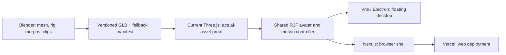

# Sprout / Prism production workflow

Prepared **2026-10-10**. **Sprout is the selected character; Prism is the selected palette.** Final compact/expanded layout remains open. This is a production runbook, not a completed Sprout implementation. The running application still uses Ribbon v001.

The target is one original expressive character with clean interrupted animation and a readable expandable conversation panel. Each pass produces inspectable assets or recordings. Accessories are outside the first proof.

## Pipeline and current application

The proposed web pipeline is sound:

**Blender → GLB → React Three Fiber / Three.js → Next.js → Vercel.**

The inspected InsightOS checkout currently uses **React 19 + Vite 8 + Electron 44 + direct Three.js 0.186.1**, without Next.js or R3F. Its Vercel configuration builds a Vite public preview. First prove the exported Sprout in that working renderer; then package a bounded R3F component for the existing desktop host and a later Next.js browser host.

| Layer                           | Responsibility                                                                         |
| ------------------------------- | -------------------------------------------------------------------------------------- |
| Image generation                | Original comparison boards, silhouette/color references and critique                   |
| Blender / connected scene tools | Editable geometry, rig, shape keys, clips and controlled camera/light studies          |
| GLB                             | Portable geometry, supported PBR materials, skinning, morphs, hierarchy and animations |
| Three.js / R3F                  | Rendering, instance lifecycle, animation blending, gaze and reactions                  |
| React HTML/CSS                  | Conversation, status, composer, focus, disclosure and panel motion                     |
| Electron                        | Floating native window, dragging, display bounds and existing desktop bridge           |
| Next.js                         | Optional browser shell around the shared client component                              |
| Vercel                          | Hosting the chosen web build and static assets                                         |

Image generation supplies the reference boards. Use the connected Higgsfield bridge for supported scene inspection/blocking and controlled camera studies during authoring; Blender remains the source of editable geometry and animation. Record actual source scenes, settings and exported results for every comparison. The portfolio method carried forward is annotated reference → clay/pose study → matched lighting → real export → app critique.

The [Higgsfield upstream audit](HIGGSFIELD-UPSTREAM.md) checks the user's additional workflow point by point. Generated meshes and editable 3D Jutsu GLBs may enter as preserved starter assets, followed by scale/topology/UV/rig/clip inspection and Blender refinement. Generated motion is a compatibility-checked starting study; optional background images/video belong to presentation contexts. Shipped interaction uses local assets and has no Higgsfield API, MCP or authoring-session dependency.

Use **GLB** for the production character. Blender's procedural shaders, Cycles softboxes, compositor, constraints and physics do not automatically become browser behavior. Bake authoring motion into portable channels, use supported materials, and recreate the reflection studio in Three. The glTF punctual-light extension covers point, spot and directional lights, rather than Cycles area lights. See the [Blender exporter manual](https://docs.blender.org/manual/en/latest/addons/scene_gltf2.html), [glTF specification](https://registry.khronos.org/glTF/specs/2.0/glTF-2.0.html) and [light extension](https://github.com/KhronosGroup/glTF/blob/main/extensions/2.0/Khronos/KHR_lights_punctual/README.md).

Match silhouette, eyes, pose, color distribution and broad highlights in the actual app. A generated reference or offline render cannot establish identical WebGL pixels.

## Build order and review gates

| Pass                      | Output                                                                                                                     | Proceed when                                                                                                |
| ------------------------- | -------------------------------------------------------------------------------------------------------------------------- | ----------------------------------------------------------------------------------------------------------- |
| 1. Reference extraction   | One Sprout sheet: front/three-quarter silhouette, short unequal buds, stubby feet, eye proportions and Prism color zones   | Identity is clear without a support; desired mechanisms are annotated from the examples below               |
| 2. Clay blockout          | Editable separate scene, semantic parts, fixed camera and captures at current 40–44px, proposed 96px pet and 160px preview | Eyes/silhouette read; buds/feet do not crowd the face; larger native bounds remain a proposal               |
| 3. Rig and clay motion    | Minimal FK rig, fixed-topology jelly morphs, independent lids/gaze; Idle, Listen, Click and Blink clips                    | Seam motion is clean; face remains stable; controls have distinct property owners                           |
| 4. Exported motion proof  | Original GLB, clip/morph manifest, validation report and replay in current Three                                           | Exported animation survives; rapid transitions do not snap; blink/click do not overwrite phase/jelly        |
| 5. Prism look development | Matched neutral/Prism materials and studio lighting in Blender/app; transparent authored fallback                          | Navy eyes/blue face stay clear; violet/coral is controlled; deformation preserves highlight quality         |
| 6. R3F packaging          | Shared avatar adapter reusing the proven asset/controller; host parity recording                                           | Framing, interruptions, lifecycle and fallback match; animated instances have independent rigs/mixers       |
| 7. Panel choreography     | Reversible shell coordinator, safe native bounds sequencing, stable composer/text and focus                                | Open/close/open reaches latest intent without clipping, lost draft or stale resize callback                 |
| 8. Performance/delivery   | Production trace, desktop/background recordings, reduced-motion/failure proof and asset handoff                            | Measured results support active-motion target; preview URLs return actual GLB bytes; changes are reviewable |

[ANIMATION-WORKFLOW.md](ANIMATION-WORKFLOW.md) is canonical for rig, clips, export and replay. [INTERACTION-MOTION-WORKFLOW.md](INTERACTION-MOTION-WORKFLOW.md) defines panel timing, bounds, focus and reversal. [REFERENCE-RECIPES.md](REFERENCE-RECIPES.md) records source revisions, licensing and reproducible experiments. These supersede earlier Ripple-specific rig choices.

## Learn from examples by reproducing a mechanism

For each example, inspect its implementation, isolate one mechanism, reproduce it with our original asset, record the result, then keep or reject it at intended size.

| Working primary example                                                                                                                                                                                                   | Mechanism                                                   | Sprout experiment                                                                             |
| ------------------------------------------------------------------------------------------------------------------------------------------------------------------------------------------------------------------------- | ----------------------------------------------------------- | --------------------------------------------------------------------------------------------- |
| [Three.js skinning + morphs](https://threejs.org/examples/webgl_animation_skinning_morph.html)                                                                                                                            | Repeatable states and independent reactions/expressions     | Blink while listening; finish a click without restoring an obsolete phase                     |
| [Three.js animation blending](https://threejs.org/examples/webgl_animation_skinning_blending.html)                                                                                                                        | Weighted transitions and compatible clip phases             | Listen → think → speak retargets from the visible mixture without waiting for a loop boundary |
| [Three.js transmission](https://threejs.org/examples/webgl_materials_physical_transmission.html) / [Drei transmission](https://drei.pmnd.rs/?path=/story/shaders-meshtransmissionmaterial--mesh-transmission-material-st) | Native physical transmission versus scene-buffer refraction | Same Sprout/camera/lights/render size; compare eyes, highlights and measured cost             |
| [Motion layout example](https://examples.motion.dev/react/layout-animation)                                                                                                                                               | Measured movement and child scale distortion                | Decorative shell settles while text, composer and focus geometry remain stable                |
| [R3F demand rendering](https://r3f.docs.pmnd.rs/advanced/scaling-performance)                                                                                                                                             | Wake/render/settle and first-frame behavior                 | Press starts immediately; active motion continues; resting/hidden pet stops unnecessary work  |

These references supply mechanisms. Sprout's geometry, face, rig, clips and reflection artwork remain original. Code and example-asset licenses are separate; the recipes record what was inspected and what remains unverified.

## First implementation milestone

Build **one actual clay Sprout GLB**, with four initial clips, then run:

**Idle → click → listening during click → blink + gaze → rapidly retarget base pose → reduced motion → resize/resume.**

Use the deterministic 15-second replay in the animation specification, then repeat in Electron at actual small and proposed larger sizes. After Think/Speak clips exist, extend it to listening → thinking → speaking → interruption. This proves the character before accessory variants or elaborate fluid simulation.

Then prove the panel story: open, type a draft, select preview states, interrupt, collapse and reopen with the draft preserved. Studio states are explicitly simulated; real voice validation uses the existing controls and owners.

## What makes motion clean

- **One property owner.** One mixer/compositor owns base bones and the complete body morph vector. Blink owns lid transforms; click owns a reaction root; gaze owns unkeyed eye nodes. Separate morph names alone do not prevent full-array GLB weight-track conflicts.
- **Retarget from the visible pose.** Blend current weights without resetting contributing actions. Operation tokens prevent an old animation completion from overwriting a phase or shrinking a reopened panel.
- **Immediate truth.** Status, Stop and voice interruption never wait for decoration. Initial speaking motion is phase-driven; later optional measured levels come from the existing voice owner.
- **Elapsed-time animation.** Advance the mixer once per rendered frame; use time-based gaze damping; reset the clock after hidden/restored periods. A 24fps authored clip can interpolate during 60fps rendering.
- **Stable reading.** Animate avatar and decorative shell, not conversation font/spacing/input scale. Expand native bounds before revealing content; finish the visible exit before shrinking.
- **Measured smoothness.** Target 60fps during active reactions and panel motion on the reference desktop. Current 15/30fps caps are a baseline to change and measure. Quiet idle can rest on demand.

A planted foot pose later needs authored contact windows and compatible transitions. The first proof floats, retaining stubby feet. Accessory choices do not block it.

For Prism lookdev, encode the broad aqua/violet/coral sweep in exportable base color, initially vertex color or a baked texture. Keep the eyes opaque and outside the transmissive body. Compare glossy jelly and physical transmission under one broad key, soft fill and cool rim, then tune one variable at a time. Save camera/exposure/reflection settings with each proof so browser differences can be diagnosed.

## Export, performance and hosts

Finish topology operations before shape keys. For the inspected Blender exporter, keep **Apply Modifiers false** on the runtime morph mesh. Use named NLA tracks and audit actual exported channels rather than trusting checkbox intent.

Run the [Khronos validator](https://github.khronos.org/glTF-Validator/), then audit expected joints/nodes, morph POSITION/NORMAL counts, clip ownership/duration, animated bounds, supported extensions and finite data. File validity alone does not prove visual quality.

Measure exported bytes/vertices, first load, frame intervals/stalls, draw calls, memory and repeated mount/unmount. Profile transmission, blur, shadows and render scale. Preserve lazy loading, fallback, reduced motion, Pause motion, visibility suspension and context recovery. Optimize after the canonical export passes; preserve it and compare semantic manifests after [glTF Transform](https://gltf-transform.dev/cli) operations.

R3F 9 matches React 19 according to the [official introduction](https://r3f.docs.pmnd.rs/getting-started/introduction); verify compatible Drei/Three versions before installing. Cached GLBs are templates: clone skinned hierarchies for independent animation and do not dispose shared cached resources from one instance's cleanup.

A later Next.js host needs an interactive client boundary and a client-side dynamic canvas wrapper where browser-only rendering is required. Read that host's installed Next documentation before code changes. The workspace root's unrelated Next project is not InsightOS. Vercel already supports the [current Vite public host](https://vercel.com/docs/frameworks/frontend/vite); migration is a separate delivery choice. Check deployed GLB URLs for binary content rather than HTML fallback. Public preview microphone restrictions remain separate from the full local companion.

## Handoff and collaboration

The eventual bundle contains a versioned GLB, matching transparent fallback, editable Blender source/checkpoint, camera/light settings, clip/morph/node manifest, validation report, hash and short Blender/browser/desktop recordings. These are proposed outputs, not assets created by this document.

Preserve the uncompressed canonical export. Optional Meshopt/Draco delivery requires matching loader support; KTX2 requires appropriate renderer detection and actual texture benefit. Use selective transforms and compare semantic manifests after each step. Required empty gaze nodes, names, morph normals and animation tracks must survive pruning/deduplication. Geometry-changing reductions happen before deformation authoring or require rebuilding and revalidating that data.

Continue on **ui/presentation-polish**, in the fork and [existing draft UI PR](https://github.com/Wasseem10/insightos/pull/1). One owner mutates the live Blender scene; others research or critique exported stills. Commit assets with their consuming renderer changes. Your cousin owns backend planning, provider sessions, OCR, database verification, financial logic and execution; visuals consume a narrow presentation adapter.

The next concrete pass is the **Sprout clay blockout and four-clip GLB proof**. The user subsequently requested prompt creation after the upstream audit; [MASTER-PROMPT.md](MASTER-PROMPT.md) now consolidates the implementation brief with a compact portrait starting layout. Its final layout remains subject to actual prototype review.
