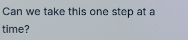
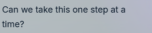

# Sharp content during pointer tilt

The hover blur came from rotating `.buddy-visual-plane` while it contained the entire header, avatar, transcript and composer. Corner positions introduced fractional perspective transforms into the text's ancestor chain. Actual before captures in both review routes showed softened text. [Chromium's compositing overview](https://www.chromium.org/developers/design-documents/gpu-accelerated-compositing-in-chrome/) explains how rasterized layers are composited through their transform hierarchy; this diagnosis is also supported by the local captures and DOM measurements below.

The visual plane now contains only the decorative glass, rim, light and shadow. It remains a separate tilt owner behind the fixed content. The header, avatar, text and controls are siblings outside it. The existing glass element retains its opening animation and backdrop filter, avoiding the earlier backdrop-root failure. Tilt angles, settling, reduced-motion/editing/menu/native-drag gates, avatar gaze, pointer surface, native bounds and voice/backend contracts are unchanged.

## Actual corner-hover comparison

Same text in the character studio at the bottom-right tilt limit:

Before:



After:



The [before report](../../../artifacts/sprout-sharp-tilt-v010/before/report.json) and [after report](../../../artifacts/sprout-sharp-tilt-v010/after/report.json) use the actual local panel and character studio, with a static PNG avatar to isolate typography. At the same ±1.152° yaw / ±0.432° pitch, the after text rectangles are exactly equal to their neutral values and have no transformed ancestors. The source screenshots are unedited; their backdrop color can differ slightly as the glass leans.

## Verification

- Production build and TypeScript pass. Twelve existing panel/tilt/browser cases pass, including native acknowledgment, reversal, focus, draft/selection/scroll, retry and reduced-motion paths.
- The strengthened tilt regression then passes separately: real header, title, messages, form, textarea, buttons and avatar slot are represented; their bounds remain exact at both opposite corners, with no transformed ancestors. The decorative plane still has a nonzero transform.
- [Active frost proof](../../../artifacts/sprout-sharp-tilt-v010/active-tilt/report.json) passes at both yaw extremes with the retained opening animation. Observed backdrop stripe edge steps fall from 50 to 2.667 with the shipped filter, so the glass still samples and softens the owned page background.
- [Native Electron proof](../../../artifacts/sprout-sharp-tilt-v010/buddy-panel-native-verification.json) passes normal/200% control containment, fixed controls across both tilt directions, native bounds, zero tilt-driven resize, reversal, workspace return, preserved reading position and controlled background captures. It uses the actual v006 WebGL avatar. The test now queries controls outside the decorative plane and rejects an empty control sample.

Reproduce the focused checks with:

```powershell
$env:INSIGHTOS_PROOF_TAG='sprout-sharp-tilt-v010'
npx playwright test tests/e2e/buddy-tilt.spec.ts tests/e2e/buddy-panel-preview.spec.ts tests/e2e/desktop-panel.spec.ts
node scripts/verify-buddy-tilt-frost.mjs --proof-tag=sprout-sharp-tilt-v010
node scripts/smoke-buddy-panel.mjs --controlled-backgrounds --zoom-review --asset=sprout-v006.glb --canonical=sprout-daylight-v006.glb --proof-tag=sprout-sharp-tilt-v010
```

These checks do not establish a new frame-budget measurement, physical window dragging, live voice, other display/DPI configurations or packaged installation. The earlier first-use tilt timing limitation remains documented in the avatar delivery. Original and Daylight assets are unchanged.
