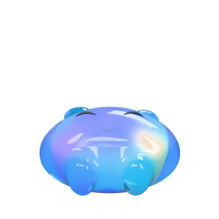

# Sprout soft Original v008

This version puts the approved Original v005 materials and shell colors onto the latest v007 animated character. It retains all eleven animations, including the planted speaking gesture, happy eye closure, sleeping, waking and joy jump. Browser eye tracking, body attention and click bounce can continue using the unchanged object hierarchy and morph/rig contract.

## Files

- Editable source: [source/sprout-soft-original-v008.blend](source/sprout-soft-original-v008.blend)
- Complete reopened Blender export: [sprout-soft-original-source-v008.glb](sprout-soft-original-source-v008.glb)
- Canonical asset: [sprout-soft-original-v008.glb](sprout-soft-original-v008.glb)
- Runtime asset: `public/buddy/sprout-v008.glb`
- Versioned idle/sleep references: `public/buddy/sprout-v008.png`, `public/buddy/sprout-v008-sleep.png`
- Settings and hashes: [sprout-soft-original-v008.manifest.json](sprout-soft-original-v008.manifest.json)

Canonical/runtime SHA256: `1f86fbf8d11d00491d1cd41b72c066f1eadd5bff01a70a0cd75c75c4995bfe85` (**1,460,216 bytes**).

The two reference PNGs are exact copies of the approved v005 Cycles renders, with that provenance recorded in the manifest. They are neither new renders nor screenshots of the animated browser version. Fresh source renders are linked below.

## What changed

Two material dictionaries and the shell's `COLOR_0` stream are restored exactly from v005. Shell roughness returns from 0.11 to 0.06, transmission from 0.80 to 0.88, clearcoat from 0.52 to 0.85, coat roughness from 0.10 to 0.045, and core emission from 0.78 to 1.10. Original vertex colors remove the Daylight red/green multipliers of 0.78/0.90.

Everything else in the runtime GLB is exact v007: every JSON field except those materials, and every binary byte outside the shell color range `[244608, 305760)`. Positions, normals, skin weights, morph targets, textures, all eleven animation dictionaries and their samples stay unchanged. The independent verifier also checks the **actual complete Blender source export**, so this is not only a runtime packaging assertion.

The new Blender scene restores the source Original lights, reflection cards and world. It was authored in an isolated background Blender 5.2.2 process. Existing v005, v006 and v007 source/export/runtime files retain their recorded hashes; the live Blender session was untouched. The author script refuses completed versioned outputs.

## Source illumination and browser matching

The Original source uses a 550 W area key, 45 W fill and 300 W rim; reflection-card emission strengths are 18, 18, 16 and 20. The world has linear color `(0.7, 0.79, 0.9)` at strength 0.18, with Khronos PBR Neutral, exposure 0 and gamma 1. Complete colors, transforms and sizes are in the manifest. Reflection cards are hidden from the camera during source renders, as in the approved v005 reference.

Cycles light power, transmission and reflection transport do not map directly to Three.js environment intensity. The asset restores the source appearance faithfully, but browser lighting/refraction matching is a separate integration step. No production default or runtime file is changed by this asset handoff.

## Verification

- [Independent preservation audit](proofs/v008-preservation-audit.json): all eleven source/runtime animations exact, all 242 runtime and 236 source accessors exact apart from the documented shell color restoration.
- [Reopened-source render audit](proofs/v008-source-render.json): 145 speaking frames, 198 happy-eye closure samples, fixed speaking feet/root, matching shell/core morphs, verified source lighting transforms and ten unclipped Cycles renders.
- [Khronos validation](proofs/v008-gltf-validation.json): zero errors, two inherited skinned-node warnings and eight inherited unused-data information items.

| Idle                                              | Speaking                                                | Sleeping                                                   |
| ------------------------------------------------- | ------------------------------------------------------- | ---------------------------------------------------------- |
|  |  |  |

These images are actual new Cycles renders from the reopened v008 source. Browser appearance, pointer behavior and automatic state integration require their own runtime verification.

To repeat the data audit without changing source assets:

```powershell
node design/buddy/sprout/42_verify_soft_original_v008.mjs
& 'D:/Program Files/Blender Foundation/Blender 5.2/blender.exe' --background --factory-startup design/buddy/sprout/source/sprout-soft-original-v008.blend --python-exit-code 1 --python design/buddy/sprout/43_verify_render_soft_original_v008.py -- audit
```
