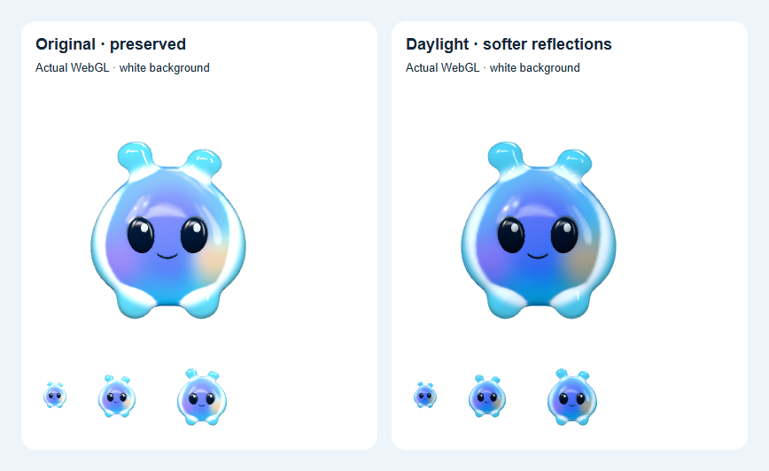

# Sprout Daylight v006

A separate appearance for the bright glass panel. Original v005 source, runtime GLB and fallback images are preserved byte-for-byte. Daylight softens the broad white reflections and gives the shell a clearer blue edge on pale backgrounds. The character, happy eye morphs, nine-joint rig and eleven animations are unchanged. The original warm coral/lavender/aqua core texture is retained, including its muted warm flank.

## Review

Open the [panel preview](http://127.0.0.1:5173/?studio=panel) or [character studio](http://127.0.0.1:5173/?studio=buddy). **Sprout appearance** switches between **Daylight** and **Original** without clearing the conversation draft. Explicit historical `asset=sprout-v003` and `asset=sprout-v004` URLs still work and show a Legacy reference selection.



The comparison uses the actual Three renderer with a fixed pose, white background, and 300/44/72/96px slots. It contains no generated replacement or post-capture material edits. [Real panel on light](../../../artifacts/sprout-daylight-v006/browser/v006-panel-light.png) · [Native bright-background capture](../../../artifacts/sprout-daylight-v006/buddy-panel-native-prism-bright.png).

## Integration

- `DesktopBuddy` and the two review studios explicitly select `/buddy/sprout-v006.glb` by default. Expanded and collapsed views use the same asset. Other undefined-asset callers, including the existing public presentation, retain the original loader default.
- The daylight reflection cards and directional light strengths follow the **successfully loaded** asset. Falling back to v005 restores its original tapered reflection profile. Choosing Original likewise restores the original material and lighting together.
- v006 has separate transparent idle/sleep PNGs. Graphics loss, reduced-motion sleep and unavailable asset recovery use the existing lifecycle and fallback paths. Appearance changes recreate and dispose the renderer while keeping the composer mounted.
- The panel glass, tilt, backend, voice provider ownership and shared contracts are unchanged in this revision.

The [asset handoff](ASSET-HANDOFF-v006.md) documents the editable Blender source, material values, versioned export/render scripts and exact preservation contract. Canonical/runtime GLB SHA256: `b8de0b88395e4b876f0eb668a0a7f39317c24d3530c9d15e58a01c7aa561824f`; size 1,445,452 bytes.

## Verification

| Check               | Result                                                                                                                                                                                                                                                                                                          |
| ------------------- | --------------------------------------------------------------------------------------------------------------------------------------------------------------------------------------------------------------------------------------------------------------------------------------------------------------- |
| Source/export       | Saved source reopened; 198 eye samples checked. [Preservation audit](proofs/v006-preservation-audit.json) passes. GLB validation has zero errors, the same two inherited skin warnings and one unused-UV information item.                                                                                      |
| Unit contracts      | Seven actual-eye and fallback tests pass, including v006 preservation of v005 eye animation ownership.                                                                                                                                                                                                          |
| Browser interaction | Nine studio, panel, behavior and appearance cases pass: joy, sleep/Zs/wake, Done gating, pause/reduced motion, graphics loss/recovery, appearance switching with a retained draft, and missing-v006 recovery to v005 with original lighting and PNG.                                                            |
| Visual comparison   | [Browser report](../../../artifacts/sprout-daylight-v006/browser/report.json): both served hashes, three panel backgrounds, 44/72/96/300px comparison, eleven clips and no asset issues. Comparison harness makes no API requests and reports no page errors.                                                   |
| Native panel        | [Electron report](../../../artifacts/sprout-daylight-v006/buddy-panel-native-verification.json): real main/preload, selected v006 hash, IPC/bounds, reversal, draft/selection/scroll, workspace return, bright/dark/busy compositor captures, tilt bounds and 200% zoom pass. API responses are local fixtures. |
| Build/review        | Default/public production builds and final TypeScript check pass. Changed runtime/test files pass Prettier and diff whitespace checks. Independent integration review found no remaining actionable defects.                                                                                                    |

Reproduce the asset and browser comparison checks:

```powershell
node design/buddy/sprout/37_verify_daylight_v006.mjs
node scripts/verify-sprout-daylight.mjs
$env:INSIGHTOS_PROOF_TAG='sprout-daylight-v006'
$env:INSIGHTOS_PROOF_ASSET_VERSION='v006'
npx playwright test tests/e2e/buddy-studio.spec.ts tests/e2e/buddy-panel-preview.spec.ts tests/e2e/sprout-daylight.spec.ts tests/e2e/sprout-behaviors.spec.ts
node scripts/smoke-buddy-panel.mjs --controlled-backgrounds --zoom-review --asset=sprout-v006.glb --canonical=sprout-daylight-v006.glb --proof-tag=sprout-daylight-v006
```

## Limits

The shell uses browser PBR transmission and a fixed reflection environment; it does not refract arbitrary desktop windows. Blender Cycles fallback renders approximate the browser material rather than promising identical pixels. Existing core hues have not been repainted.

This revision does not provide a fresh frame-budget measurement or resolve the historical 83.340ms first-use tilt interval. Live microphone/ElevenLabs, other physical displays/DPI scales, human screen-reader acceptance and packaged installation are outside these appearance checks. See the [v005 delivery](DELIVERY-v005.md) and [current light panel delivery](../frutiger-aero/SPROUT-CLEAR-GLASS-v008.md) for prior evidence and remaining limits.
